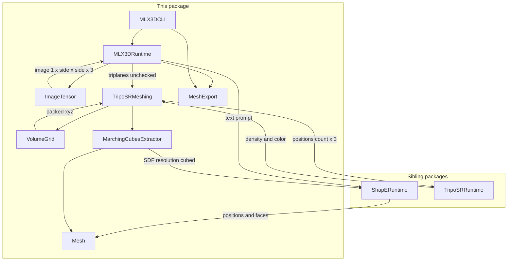

# Knowledge graph

`verified_commit` is `4d5c73ee1ad4581ede2e87fae6678b4ca51abf69` on `cursor/mlx-3d-runtime-swift-5003`. Line numbers were read from that tree. The docs commit that adds this file does not edit those source lines. Sibling modules are external and have no line numbers here.

## Where to find things

| Task | Location |
| --- | --- |
| Package pins and products | `Package.swift:1-69` |
| Text-to-mesh options and call | `Sources/MLX3DRuntime/MLX3DRuntime.swift:7-93` |
| Image decode | `Sources/MLX3DRuntime/ImageTensor.swift:6-91` |
| Image-to-mesh and image rank check | `Sources/MLX3DRuntime/MLX3DRuntime.swift:95-192` |
| Density grid and batches | `Sources/MLX3DRuntime/TripoSRMeshing.swift:5-100` |
| Sample coordinates | `Sources/MLX3DRuntime/VolumeGrid.swift:3-34` |
| Marching cubes | `Sources/MLX3DRuntime/MarchingCubesExtractor.swift:5-74` |
| Mesh topology | `Sources/MLX3DRuntime/Mesh.swift:5-90` |
| OBJ and PLY | `Sources/MLX3DRuntime/MeshExport.swift:23-172` |
| CLI | `Sources/MLX3DCLI/MLX3DCLI.swift:18-168` |
| Example link check | `Examples/Integration/Sources/MLX3DExample/MLX3DExample.swift:1-18` |
| CI | `.github/workflows/ci.yml:16-141` |
| Weight facts from sibling snapshots | `Vendor/triposr-mlx-swift/README.md:67-70`, `Vendor/shap-e-mlx-swift/README.md:63` |
| Ellipsoid test | `Tests/MLX3DRuntimeTests/MarchingCubesTests.swift:51-92` |
