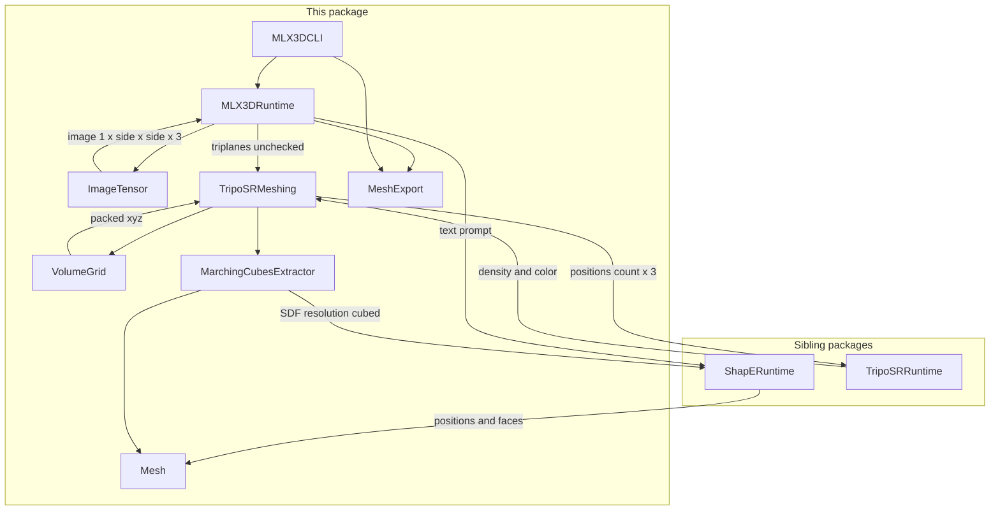

# Knowledge graph

`verified_commit` `4d5c73ee1ad4581ede2e87fae6678b4ca51abf69` on `cursor/mlx-3d-runtime-swift-5003` is a label. `scripts/verify_docs.py` does not require it to be an ancestor of `HEAD`. It hashes the cited lines in the working tree. Sibling modules are external and have no line numbers here.

## Where to find things

| Task | Location |
| --- | --- |
| Package pins and products | `Package.swift:1-68` |
| Text-to-mesh options and call | `Sources/MLX3DRuntime/MLX3DRuntime.swift:16-206` |
| Shap-E image options and call | `Sources/MLX3DRuntime/MLX3DRuntime.swift:68-122` |
| Image decode | `Sources/MLX3DRuntime/ImageTensor.swift:6-107` |
| CGImage cutout then TripoSR | `Sources/MLX3DRuntime/MLX3DRuntime.swift:239-272` |
| Cutout failure policy | `Sources/MLX3DRuntime/MLX3DRuntime.swift:46-56` |
| Copied Mesquette cutout | `Sources/MLX3DRuntime/ImageBackgroundRemoval.swift:6-199` |
| Shap-E white prep then image generation | `Sources/MLX3DRuntime/MLX3DRuntime.swift:282-323` |
| Image-to-mesh and image rank check | `Sources/MLX3DRuntime/MLX3DRuntime.swift:208-470` |
| Density grid and batches | `Sources/MLX3DRuntime/TripoSRMeshing.swift:5-106` |
| Sample coordinates and the 512 cap | `Sources/MLX3DRuntime/VolumeGrid.swift:3-68` |
| Grid rejection and lazy-batch tests | `Tests/MLX3DRuntimeTests/MarchingCubesTests.swift:104-175` |
| Marching cubes | `Sources/MLX3DRuntime/MarchingCubesExtractor.swift:5-74` |
| Mesh topology | `Sources/MLX3DRuntime/Mesh.swift:5-90` |
| OBJ and PLY | `Sources/MLX3DRuntime/MeshExport.swift:23-172` |
| CLI | `Sources/MLX3DCLI/MLX3DCLI.swift:18-168` |
| Example link check | `Examples/Integration/Sources/MLX3DExample/MLX3DExample.swift:1-18` |
| CI | `.github/workflows/ci.yml:16-151` |
| Public sibling branch pins | `Package.swift:33-41` |
| Ellipsoid test | `Tests/MLX3DRuntimeTests/MarchingCubesTests.swift:51-92` |
