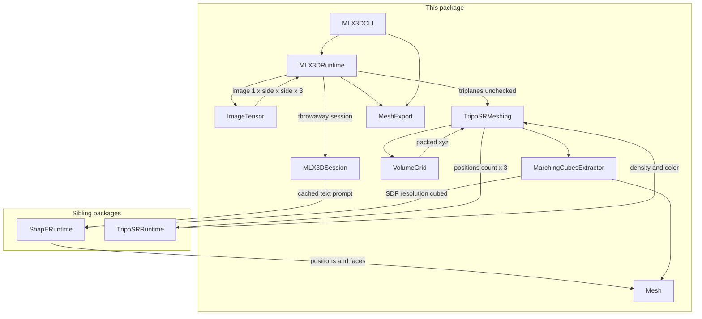

# Knowledge graph

`verified_commit` `4d5c73ee1ad4581ede2e87fae6678b4ca51abf69` on `cursor/mlx-3d-runtime-swift-5003` is a label. `scripts/verify_docs.py` does not require it to be an ancestor of `HEAD`. It hashes the cited lines in the working tree. Sibling modules are external and have no line numbers here.

## Where to find things

| Task | Location |
| --- | --- |
| Package pins and products | `Package.swift:1-59` |
| Text-to-mesh options and call | `Sources/MLX3DRuntime/MLX3DRuntime.swift:16-229` |
| Caller-owned loaded-model session | `Sources/MLX3DRuntime/MLX3DSession.swift:2-486` |
| Generation progress event | `Sources/MLX3DRuntime/GenerationProgress.swift#MLX3DGenerationEvent` |
| Shap-E partial array guard | `Sources/MLX3DRuntime/ShapEMeshArrays.swift#ShapEMeshArrays` |
| Model key | `Sources/MLX3DRuntime/MLX3DModelKey.swift:1-78` |
| In-memory load cache | `Sources/MLX3DRuntime/MLX3DModelCache.swift:1-168` |
| Shap-E image options and call | `Sources/MLX3DRuntime/MLX3DRuntime.swift#ShapEImageToMeshOptions` |
| Image decode | `Sources/MLX3DRuntime/ImageTensor.swift#ImageTensor` |
| CGImage cutout then TripoSR | `Sources/MLX3DRuntime/MLX3DRuntime.swift#MLX3DRuntime.imageToMesh` |
| Cutout failure policy | `Sources/MLX3DRuntime/MLX3DRuntime.swift#CutoutFailurePolicy` |
| Copied Mesquette cutout | `Sources/MLX3DRuntime/ImageBackgroundRemoval.swift:6-246` |
| Shap-E white prep then image generation | `Sources/MLX3DRuntime/MLX3DRuntime.swift#MLX3DRuntime.imageToMeshShapE` |
| Image-to-mesh and image rank check | `Sources/MLX3DRuntime/MLX3DRuntime.swift:231-555` |
| Density grid and batches | `Sources/MLX3DRuntime/TripoSRMeshing.swift#TripoSRMeshing` |
| Sample coordinates and the 512 cap | `Sources/MLX3DRuntime/VolumeGrid.swift#VolumeGrid` |
| Grid rejection and lazy-batch tests | `Tests/MLX3DRuntimeTests/MarchingCubesTests.swift#VolumeGridBatchTests` |
| Loaded-model cache tests | `Tests/MLX3DRuntimeTests/ModelCacheTests.swift:8-272` |
| Marching cubes | `Sources/MLX3DRuntime/MarchingCubesExtractor.swift#MarchingCubesExtractor` |
| Mesh topology | `Sources/MLX3DRuntime/Mesh.swift:5-90` |
| OBJ, PLY, and USDZ | `Sources/MLX3DRuntime/MeshExport.swift:20-743` |
| CLI | `Sources/MLX3DCLI/MLX3DCLI.swift#MLX3DCLI` |
| Example link check | `Examples/Integration/Sources/MLX3DExample/MLX3DExample.swift:1-18` |
| CI | `.github/workflows/ci.yml:16-285` |
| App-hosted USDZ tests | `Examples/ExportHost/ExportHostTests/USDZHostTests.swift#USDZHostTests` |
| Public sibling version pins | `Package.swift:25-32` |
| Ellipsoid test | `Tests/MLX3DRuntimeTests/MarchingCubesTests.swift:51-92` |
